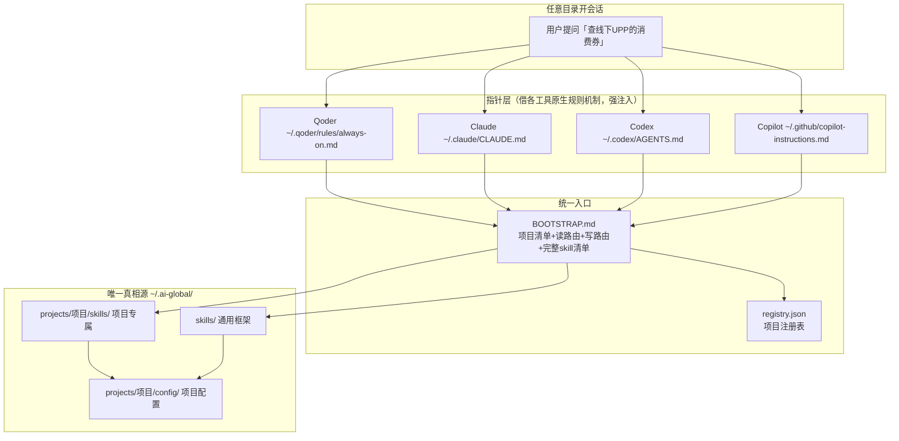

# Cross-Tool AI Setup Blueprint 搭建架构

本目录是一套一次性的搭建图纸，不是底座本身。初始化时，AI 按 `INIT.md` 和模板创建 `~/.ai-global/`、各工具指针与权限配置；初始化后，日常工作使用这些产出，不依赖本目录。

以下架构描述的是搭建结果。

## 一、搭建结果的总体架构（四层）



**核心思想**：各 AI 工具的原生规则目录互不兼容（设计时默认用户只用一个工具），所以**在工具之上加一层适配**——每个工具只放一个"指针"（符合它自己的格式），真正的 skill/规则/配置统一放在工具无关的 `~/.ai-global/`。

## 二、搭建后的目录结构

```
~/.ai-global/                      ← 唯一真相源（工具无关）
├── BOOTSTRAP.md                   ← 统一入口：项目清单+读路由+写路由+完整skill清单
├── registry.json                  ← 项目注册表（id/别名/代码路径）
├── ai-tools-registry.json         ← 实际接入工具及权限配置入口
├── PERMISSIONS.md                 ← 本机权限适配方法，后续同步不依赖图纸
├── rules/                         ← 通用规则
├── scripts/                       ← 通用独立辅助脚本
├── skills/                        ← 通用 skill（框架，改一处全生效）
│   ├── log-query/                 ← 日志入口
│   ├── beacon-log-query/          ← 日志后端
│   ├── stg-db-query/              ← 查库框架
│   ├── yunxiao-release/           ← 发版框架
│   └── ...                        ← 其他通用 skill
└── projects/                      ← 项目专属（框架/配置分离）
    └── <项目>/
        ├── skills/                ← 项目专属 skill
        ├── scripts/               ← 项目专属独立辅助脚本
        └── config/                ← 项目专属配置（索引/数据源/应用参数）
```

## 三、生成的指针体系（两层）

| 层 | 位置 | 内容 | 生效范围 |
|---|---|---|---|
| **全局指针** | 各工具全局规则文件 | 项目速查表三列 + 通用 skill 清单 + 要求读 BOOTSTRAP.md | 任意目录 |
| **项目级指针**（可选） | `<项目>/.qoder/rules/ai-global.md`、`AGENTS.md`、`CLAUDE.md` | 本项目专属 skill 清单 | 仅项目目录开会话 |

> 核心依赖是「全局指针 + BOOTSTRAP.md」；项目级指针是可选的便利层。

## 四、初始化后的核心链路（读 skill）

```
用户：「查线下UPP的消费券」
  ↓ ① 项目语义匹配（速查表三列，强注入）
  线下UPP → /Users/xxx/UPP → projects/upp/
  ↓ ② 读 BOOTSTRAP.md 完整清单
  线下UPP 有 gov-coupon-investigation（政府消费券排查）
  ↓ ③ 触发词匹配（读 SKILL.md 的 description）
  命中 → 读全文执行
  ↓ ④ 按需调通用框架 + 项目 config
  log-query（读项目索引）+ stg-db-query（读项目数据源）
```

## 五、访问与执行权限

初始化 Agent 负责把同一授权范围适配到所有接入工具的原生配置，访问权限和脚本执行权限都要配置，不能只给文件读取权限。

- 共享范围：`~/.ai-global/**`，包括后续创建的独立辅助脚本。
- 项目范围：`registry.json` 中所有 `code_path`，即使位于共享目录外，也对所有接入工具配置访问、执行权限。
- 指针范围：各工具指针文件及其明确指向的文件/目录。

初始化时将工具清单与权限指南保存到共享目录，生成后的 BOOTSTRAP 负责说明后续同步规则。新增项目时同步所有工具，新增脚本时补齐不支持目录通配的执行规则，接入新工具时覆盖全部既有范围；不在日常使用时重复申请同一范围的授权。

## 六、关键机制（踩坑点）

1. **Qoder 规则需 frontmatter**：`alwaysApply: true` 才会被识别为 always_on 并加载，否则整个文件被忽略。
2. **.qoder/.claude 不进 git**：这些目录通常被 .gitignore 忽略，删除前必须先跨目录 diff/md5 保留最新版。
3. **框架/配置分离**：SKILL.md 通用 + 同目录 config 项目专属时，框架留 `skills/` 一份、config 抽到 `projects/<项目>/config/`。
4. **语义路由而非目录路由**：项目从"会话所在目录"抽象成"用户口头说的项目名"，所以任意目录都能定位。
